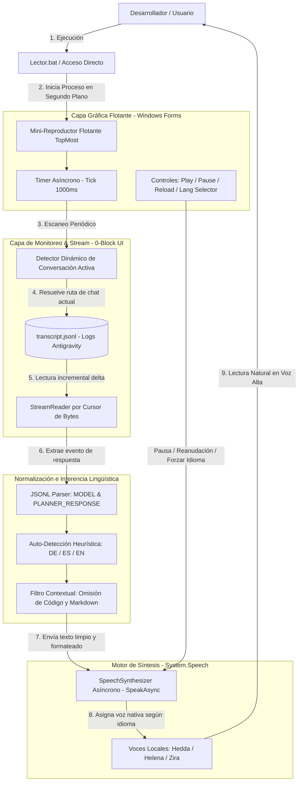

# Arquitectura de (Antigravity Voice Reader)

Este documento detalla la arquitectura de software, flujos de datos asíncronos y diseño técnico del proyecto **Antigravity Voice Reader**, una herramienta flotante de síntesis de voz (Text-to-Speech) con detección inteligente multilingüe y monitoreo en tiempo real de cero bloqueos (0-Block UI) diseñada para el entorno Antigravity IDE.

## Tecnologías usadas
```javascript
const AntigravityVoiceReader_Project = {
    code: ["PowerShell 5.1+", ".NET Framework"],
    technologies: {
        devTool: ["VSCode", "Antigravity IDE"],
        apis: ["System.Speech.Synthesis", "Windows Forms (.NET)"],
        assets: ["0-Block FileStream", "Multi-Language Auto-Switch"]
    }
};
```
---
## 1. Arquitectura de Software y Flujo de Datos

Antigravity Voice Reader implementa una arquitectura desacoplada y orientada a eventos locales. Su núcleo combina un monitor asíncrono de puntero de bytes (`StreamReader`) sobre el archivo de registro `transcript.jsonl` del IDE con un motor de inferencia lingüística y síntesis en paralelo (`System.Speech.Synthesis`), garantizando que la interfaz flotante (`TopMost`) permanezca ágil y reactiva sin consumir ciclos de CPU innecesarios.



## 2. Configuración y Parámetros del Sistema

A continuación, se describen los parámetros operativos, componentes del sistema y perfiles de voz configurados para garantizar compatibilidad nativa en entornos Windows 10/11:

| Parámetro / Componente | Tipo | Valor Predeterminado / Asignación | Descripción Semántica |
| :--- | :---: | :--- | :--- |
| `TranscriptPath` | Ruta dinámica | `%USERPROFILE%\.gemini\antigravity-ide\brain\<id>\...` | Ubicación del log JSONL de la conversación activa en el IDE. |
| `TimerInterval` | Numérico (ms) | `1000` | Intervalo del temporizador en segundo plano para verificar deltas. |
| `SpeechRate` | Entero | `0` (Rango de modulación: -10 a 10) | Velocidad de reproducción calibrada para articulación natural. |
| `Voice_DE` | String (.NET) | `Microsoft Hedda Desktop` | Voz nativa para alemán con soporte fonético exacto de diéresis (ä, ö, ü, ß). |
| `Voice_ES` | String (.NET) | `Microsoft Helena Desktop` | Voz nativa para español peninsular / neutro. |
| `Voice_EN` | String (.NET) | `Microsoft Zira Desktop` | Voz nativa para inglés estadounidense. |
| `UIMode` | Enum | `Compact` (Mini-Player) / `Expanded` | Modalidad de visualización de la ventana flotante siempre visible. |
| `LanguageMode` | Enum | `Auto`, `Español`, `Deutsch`, `English` | Selector manual para fijar el sintetizador o permitir auto-detección. |

## 3. Sinergias de Rendimiento, Accesibilidad y Privacidad (0-Block & DSGVO)

> [!IMPORTANT]
> El proyecto ha sido concebido bajo principios de diseño de bajo consumo de recursos, accesibilidad universal para desarrolladores con fatiga visual o TDAH, y estricta privacidad por diseño.

- **0-Block UI (Lectura Incremental por Bytes)**: En lugar de cargar repetidamente en memoria un archivo de historial que puede crecer varios megabytes, el lector almacena un puntero numérico (`lastFilePos`) y realiza lecturas directas exclusivamente sobre los nuevos bytes generados desde el último ciclo, evitando cuellos de botella y congelamientos en la interfaz.
- **Normalización Contextual Inteligente**: El motor identifica bloques de código fuente, enlaces web y sintaxis Markdown mediante expresiones regulares optimizadas, reemplazándolos de manera contextual según el idioma detectado (*"código omitido"* en español, *"Code ausgelassen"* en alemán, *"code omitted"* en inglés) para brindar una experiencia auditiva limpia y comprensible.
- **Privacidad Local Absoluta (DSGVO / GDPR Compliance)**: Todo el procesamiento y la síntesis se ejecutan al 100% de forma local y offline mediante `System.Speech.Synthesis`. No se realiza ninguna petición de red, no se consumen tokens ni cuotas de APIs externas, y los datos jamás abandonan la estación de trabajo.
- **Accesibilidad Multilingüe con Auto-Switch**: Conmuta dinámicamente entre las voces instaladas en Windows analizando patrones ortográficos característicos, permitiendo alternar sesiones de programación y consultas técnicas en español, alemán o inglés sin intervención manual.

### 📁 Estructura de Directorios

```text
antigravity-voice-reader/
├── 📄 Instalar_Acceso.bat     # ⚡ Instalador interactivo que crea el acceso directo en el Escritorio
├── 📄 Lector.bat              # 🚀 Lanzador principal: inicializa PowerShell en modo silencioso
├── 📄 Lector_DE.bat           # 🇩🇪 Lanzador directo con preselección forzada en idioma alemán
├── 📄 reader_gui.ps1          # 💻 Núcleo lógico: GUI WinForms, StreamReader de bytes y motor TTS
├── 📄 install.ps1             # ⚙️ Script de aprovisionamiento de accesos y rutas de entorno
├── 📄 Project.md              # 🏗️ Documento maestro de arquitectura y especificación técnica
├── 📄 README.md               # 📖 Documentación principal y manual rápido de uso (Español)
├── 📄 README.de.md            # 🇩🇪 Documentación técnica en Alemán
├── 📄 README.en.md            # 🇺🇸 Documentación técnica en Inglés
└── 📄 SECURITY.md             # 🛡️ Políticas de seguridad y canal de reporte responsable
```

---
> [!NOTE]
> **Explorar siguientes proyectos:**
> *   [`RedLocalBlock`](./RedLocalBlock.md)
> *   [`MyBC`](./MyBC.md)
> *   [`UmzugEstimator`](./UmzugEstimator.md)
> *   [`ArteQ`](./ArteQ.md)
> *   [`ArteQ-IT`](./ArteQ-IT.md)
> *   [`PropuestaGlow`](./PropuestaGlow.md)
> *   [`3D_Scan`](./3D_Scan.md)
---
<br>
<p align="center">
  <small>All rights reserved © 2026 | <a href="https://github.com/dwn10">Darwin Paz</a></small>
</p>
