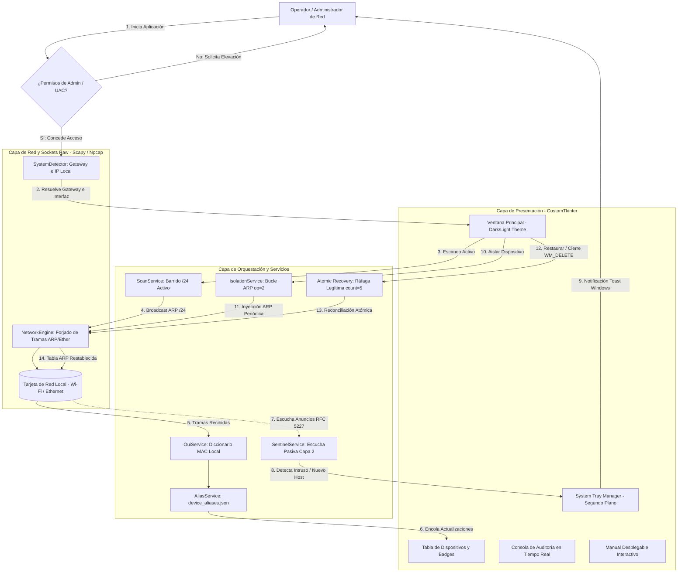

# Arquitectura de (RedLocalBlock)

Este documento detalla la arquitectura de software, flujos de red en Capa 2 (ARP), modelos de concurrencia y diseño técnico del proyecto **RedLocalBlock**, una herramienta moderna de escritorio para auditoría, descubrimiento pasivo/activo e interrupción controlada de acceso en redes locales desarrollada bajo el protocolo Clean-Room.

## Tecnologías usadas
```javascript
const RedLocalBlock_Project = {
    code: ["Python 3.11+", "CustomTkinter", "Scapy 2.5+"],
    technologies: {
        devTool: ["VSCode", "Git", "Pip", "PyInstaller"],
        network: ["Scapy", "Npcap", "Sockets Raw", "RFC 826 ARP", "RFC 5227"],
        ui: ["CustomTkinter", "Pillow", "Dark/Light Mode", "Pystray"],
        security: ["Clean-Room Protocol", "UAC/Root Check", "Atomic ARP Recovery", "Local-Only"]
    }
};
```
---
## 1. Arquitectura de Software y Flujo de Datos

RedLocalBlock adopta una arquitectura desacoplada y orientada a eventos para garantizar máxima resiliencia de red y una interfaz de usuario a 60 FPS sin bloqueos. Su diseño separa estrictamente el motor de bajo nivel (`NetworkEngine`), los servicios de descubrimiento y orquestación (`ScanService`, `SentinelService`, `IsolationService`) y la capa visual en CustomTkinter mediante colas de mensajes bidireccionales (`queue.Queue`).



## 2. Parámetros del Sistema y Configuración de Red

La siguiente tabla resume los parámetros operativos, configuraciones de Capa 2 y mecanismos de persistencia utilizados en entornos Windows 10/11 y Linux:

| Parámetro / Componente | Tipo | Valor Predeterminado / Rango | Descripción Semántica |
| :--- | :---: | :--- | :--- |
| `NetworkInterface` | String | Auto-detección | Adaptador físico o inalámbrico activo resuelto dinámicamente vía Scapy. |
| `GatewayIP` | IPv4 | Auto-detección (`conf.route.route`) | Dirección de la puerta de enlace predeterminada, blindada contra auto-aislamiento. |
| `SubnetRange` | CIDR | `/24` (254 direcciones) | Rango de direcciones IPv4 sondeadas durante el escaneo activo bajo demanda. |
| `SentinelMode` | Booleano | `True` (Daemon pasivo) | Escucha pasiva de tramas *ARP Announcement/Probe* (RFC 5227) con 0 bytes inyectados. |
| `IsolationInterval` | Numérico | `2.0 segundos` | Frecuencia de ráfagas ARP desasociativas (`op=2`) para mantener el aislamiento del intruso. |
| `RecoveryBurstCount` | Entero | `5 paquetes` | Ráfagas legítimas transmitidas al router y a la víctima para restaurar la conectividad. |
| `AliasesStorage` | Archivo | `device_aliases.json` | Almacenamiento local persistente de nombres descriptivos y notas asignadas a cada MAC. |
| `ThemeMode` | Enum | `System` / `Dark` / `Light` | Modo visual de alto contraste accesible conforme al estándar WCAG 2.1 AA/AAA. |

## 3. Sinergias de Resiliencia, Concurrencia y Privacidad (Local-First & DSGVO)

> [!IMPORTANT]
> RedLocalBlock opera bajo un estricto protocolo de seguridad defensiva, garantizando que ninguna acción comprometa la estabilidad del host local o viole las regulaciones de telecomunicaciones.

- **Garantía de Reconciliación Atómica (Anti-DoS accidental)**: Uno de los riesgos críticos en herramientas de red es dejar a los dispositivos aislados si el programa finaliza inesperadamente. RedLocalBlock implementa un triple mecanismo de recuperación (`atexit.register()`, interceptación del evento `WM_DELETE_WINDOW` y manejadores de señales `SIGINT/SIGTERM`), que inyecta automáticamente una ráfaga de 5 paquetes ARP de reconciliación legítima antes de liberar el socket.
- **Invariante de Protección de Infraestructura**: El Gateway predeterminado y la dirección IP/MAC de la máquina operadora están blindados a nivel de código (`es_gateway == True` o `es_local == True`), bloqueando cualquier intento de auto-aislamiento accidental.
- **Concurrencia Thread-Safe sin Bloqueo de UI**: Las operaciones de red de Scapy se ejecutan en hilos dedicados y transmiten su estado a través de `queue.Queue`. El hilo principal de CustomTkinter procesa la cola de forma periódica (`app.after(100, ...)`), logrando una interfaz gráfica fluida y responsiva a 60 FPS.
- **Modo Centinela con Cero Tráfico Adicional (Zero-Overhead Sniffing)**: Aprovecha las características de la especificación RFC 5227: todo dispositivo que se conecta a una red emite obligatoriamente anuncios ARP de difusión (`FF:FF:FF:FF:FF:FF`). El centinela captura estas tramas en milisegundos sin generar un solo bit de tráfico en la red, disparando notificaciones nativas en la bandeja del sistema (*Windows Toast*).
- **Privacidad Local y Soberanía de Datos (DSGVO / GDPR y TDDDG)**: Funcionamiento 100% *Local-First*. La resolución de fabricantes (OUI) se realiza mediante un diccionario interno sin consultar APIs externas. No existe telemetría, no se capturan contraseñas ni contenidos de paquetes (sin DPI / sin MITM a nivel de capa de aplicación), protegiendo la confidencialidad de la red.

### 📁 Estructura de Directorios

```text
RedLocalBlock/
├── 📄 Iniciar.bat                  # 🚀 Lanzador amigable con verificación y elevación de permisos UAC
├── 📄 compilar_exe.bat             # 📦 Script de empaquetado standalone con PyInstaller
├── 📄 device_aliases.json          # 💾 Base de datos local-first de alias y nombres de dispositivos
├── 📄 requirements.txt             # 📌 Dependencias fijadas para producción (Scapy, CustomTkinter, etc.)
├── 📄 Project.md                   # 🏗️ Especificación técnica y arquitectura de referencia Clean-Room
├── 📄 README.md                    # 📖 Manual de usuario y documentación técnica (Español)
├── 📄 README.de.md                 # 🇩🇪 Documentación del sistema en Alemán
├── 📄 README.en.md                 # 🇺🇸 Documentación del sistema en Inglés
├── 📄 SECURITY.md                  # 🛡️ Políticas de seguridad y auditoría ética
├── 📂 docs/                        # 📑 Recursos gráficos y capturas de interfaz
├── 📂 src/                         # 💻 Código Fuente Principal
│   ├── 📄 main.py                  # Entry point: verificación de permisos y arranque
│   ├── 📂 core/                    # Núcleo de bajo nivel de red
│   │   ├── 📄 network_engine.py    # Inyección de tramas ARP y reconciliación atómica
│   │   ├── 📄 permissions.py       # Chequeo preventivo de privilegios Administrador/Root
│   │   └── 📄 system_detector.py   # Detección multiplataforma de interfaz, Gateway e IP
│   ├── 📂 models/                  # Contratos de datos y máquina de estados
│   │   └── 📄 device.py            # Modelo de entidad de dispositivo y validaciones
│   ├── 📂 services/                # Orquestación de casos de uso
│   │   ├── 📄 alias_service.py     # Gestor de persistencia de apodos locales
│   │   ├── 📄 isolation_service.py # Ciclo de vida de aislamiento con hilos concurrentes
│   │   ├── 📄 oui_service.py       # Resolución local de fabricantes por prefijo MAC
│   │   ├── 📄 scan_service.py      # Barrido activo de subred /24
│   │   └── 📄 sentinel_service.py  # Escucha pasiva en segundo plano (RFC 5227)
│   └── 📂 ui/                      # Interfaz gráfica moderna en CustomTkinter
│       ├── 📄 app.py               # Ventana principal y layout maestro
│       ├── 📄 theme.py             # Paleta de colores accesible Dark/Light (WCAG)
│       └── 📂 components/          # Widgets modulares (Tabla, Consola, Tray, Manual, Footer)
└── 📂 tests/                       # 🧪 Batería de pruebas unitarias automatizadas
```

---
> [!NOTE]
> **Explorar siguientes proyectos:**
> *   [`AntigravityVoiceReader`](./AntigravityVoiceReader.md)
> *   [`MyBC`](./MyBC.md)
> *   [`UmzugEstimator`](./UmzugEstimator.md)
> *   [`ArteQ`](./ArteQ.md)
> *   [`ArteQ-IT`](./ArteQ-IT.md)
> *   [`PropuestaGlow`](./PropuestaGlow.md)
> *   [`3D_Scan`](./3D_Scan.md)
---
<br>
<p align="center">
  <small>All rights reserved © 2026 | <a href="https://github.com/dwn10">Darwin Paz</a></small>
</p>
